# Digital Image Processing (DIP) — Image Filtering & Image Compression

**Student:** Shreyas Lingwal — B.Tech (Hons.) Computer Science, Doon University, Dehradun
**Subject:** Digital Image Processing (Semester 7)

This repository contains two practical implementations:

1. **Image Filtering** — all **spatial-domain** filters from the professor's PDF
   *“DIP Filters: Theory and Numericals”*, applied to an **HSI image**.
2. **Image Compression** — **Huffman Coding** and **Arithmetic Coding**, both
   implemented **from scratch**, with compression + decompression and metrics.

> Frequency-domain filters in the PDF (Ideal, Butterworth and Gaussian
> Low/High-Pass, Section 3 of the PDF) are **excluded**, as instructed in the assignment.

---

## Repository Structure

```
DIP-Filtering-and-Compression/
├── README.md
├── requirements.txt
├── input/
│   └── input_image.png                  # Colour input image (used as HSI input)
├── 1_Image_Filtering/
│   ├── common.py                        # HSI conversion + kernel + sample image
│   ├── mean_filter.py
│   ├── weighted_average_filter.py
│   ├── gaussian_filter.py
│   ├── median_filter.py
│   ├── laplacian_filter.py
│   ├── sobel_filter.py
│   ├── prewitt_filter.py
│   ├── high_boost_filter.py
│   ├── filtering.py                     # Main file, runs all filters
│   └── outputs/                         # Original + every filtered output
├── 2_Image_Compression/
│   ├── huffman.py                       # Huffman coding, separate file
│   ├── arithmetic.py                    # Arithmetic coding, separate file
│   ├── compression.py                   # Main file, runs both
│   └── outputs/                         # Reconstructed images, .bin files, results
└── assets/                              # Before/after grids used in this README
```

---

## How to Run

```bash
git clone <your-repo-url>
cd DIP-Filtering-and-Compression
pip install -r requirements.txt

# Part 1 — Filtering
python 1_Image_Filtering/filtering.py

# Part 2 — Compression
python 2_Image_Compression/compression.py
```

**Use your own image:** replace `input/input_image.png` with any colour image
and re-run both scripts. The filtering code converts it to HSI itself.

---

# Part 1 — Image Filtering

## HSI input — why, and how it is handled

The input image is converted **RGB → HSI from scratch** using the textbook formulae:

- `I = (R + G + B) / 3`
- `S = 1 − min(R,G,B) / I`
- `H = acos{ 0.5[(R−G)+(R−B)] / sqrt((R−G)² + (R−B)(G−B)) }` (360° − θ if B > G)

Every filter is then applied **only on the Intensity (I) channel**. This is the
standard way to filter an HSI image: filtering the Hue channel would shift
colours, while intensity carries the detail, edges and noise that these
filters are designed for. The filtered I channel is recombined with the
original H and S and converted back **HSI → RGB** for display.

All convolutions are written from scratch (replicate padding + sliding
kernel). OpenCV is used only to read/write image files, not for filtering.

### Input image

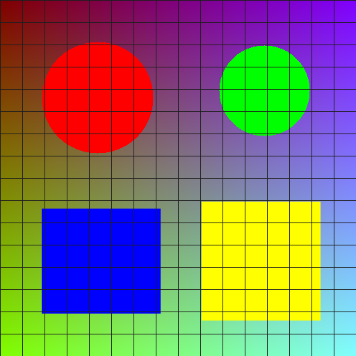

*HSI channels (H | S | I, left to right) are saved as
`1_Image_Filtering/outputs/0_hsi_channels.png`.*

## All results at a glance

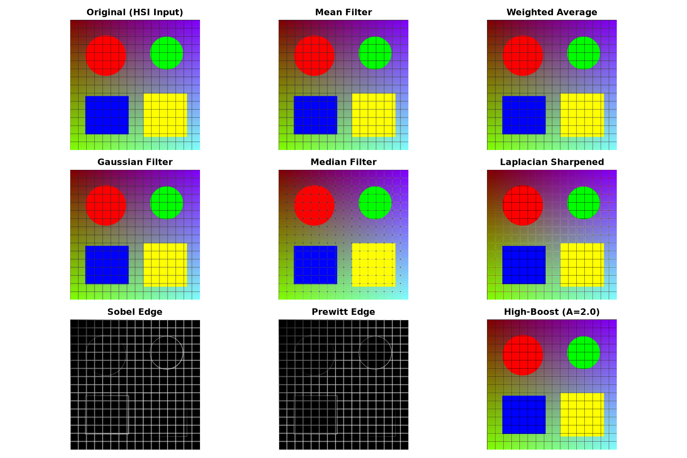

## Smoothing (Low-Pass) Filters — PDF Section 2.1

### 1. Mean / Averaging Filter
Each pixel is replaced by the average of its 3×3 neighbourhood.
Mask: `h = (1/9) × [[1,1,1],[1,1,1],[1,1,1]]`. Reduces Gaussian-type noise, but blurs edges.

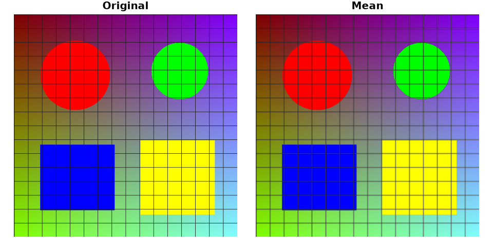

### 2. Weighted Average Filter
Centre and nearer neighbours get more weight, so detail is preserved better than the plain mean.
Mask: `h = (1/16) × [[1,2,1],[2,4,2],[1,2,1]]`

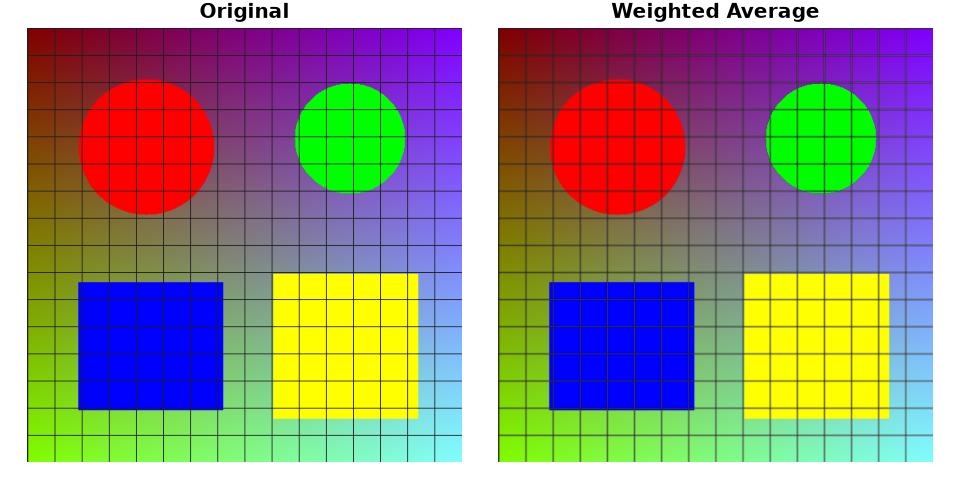

### 3. Gaussian Filter
Weights follow the Gaussian distribution `h(x,y) ∝ e^(−(x²+y²)/2σ²)` — here a 5×5 kernel, σ = 1.
Gives a smoother, more natural blur with fewer artefacts than the mean filter.

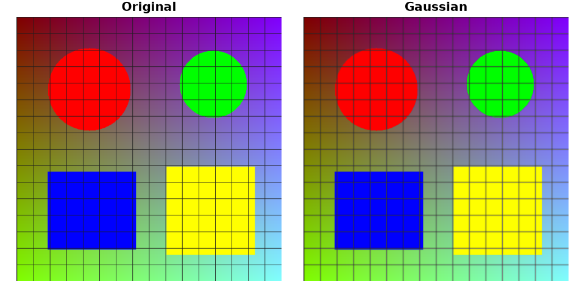

### 4. Median Filter
**Non-linear** filter: the centre pixel is replaced by the **median** of its 3×3 neighbourhood.
Best filter for **salt-and-pepper (impulse) noise**, and it preserves edges better than averaging.

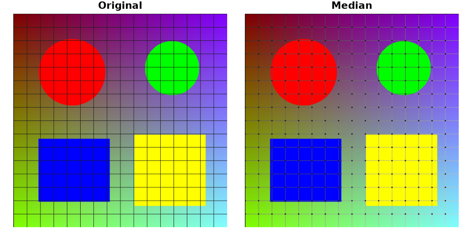

## Sharpening (High-Pass) Filters — PDF Section 2.2

### 5. Laplacian Filter
Second-order derivative. Mask: `[[0,1,0],[1,−4,1],[0,1,0]]`.
Sharpened image: `g(x,y) = f(x,y) − ∇²f(x,y)` (centre coefficient is negative).

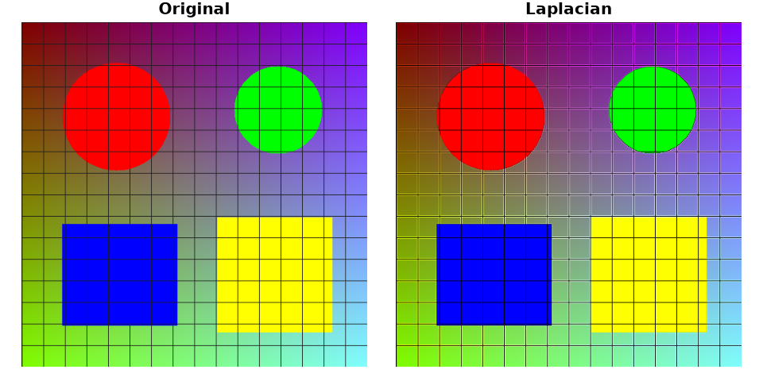

### 6. Sobel Filter
First-order gradient operator for edge detection.
`Gx = [[−1,0,1],[−2,0,2],[−1,0,1]]`, `Gy = [[−1,−2,−1],[0,0,0],[1,2,1]]`,
gradient magnitude `|G| = sqrt(Gx² + Gy²)`.

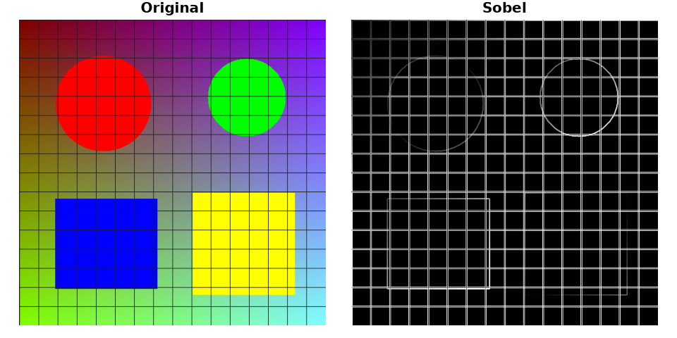

### 7. Prewitt Filter
Also a first-order gradient operator (listed in the PDF's filter classification
table, Section 1), with equal weights:
`Gx = [[−1,0,1],[−1,0,1],[−1,0,1]]`, `Gy = [[−1,−1,−1],[0,0,0],[1,1,1]]`.
Slightly simpler than Sobel, and slightly more sensitive to noise because the
centre row/column is not weighted by 2.

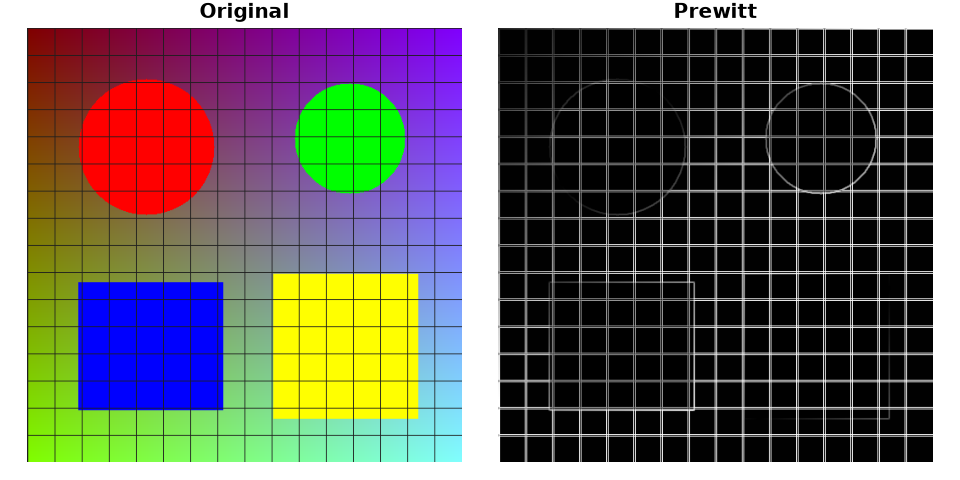

### 8. High-Boost Filtering
Amplifies high-frequency (edge) content while retaining the background:
`g(x,y) = A·f(x,y) − f_blur(x,y)`.
In a flat region `f_blur = f`, so `g = (A−1)f` — **A = 2.0** is used here, which
keeps flat regions unchanged and boosts only the edges (A = 2.5 output is also saved).


## Noise-removal demos (PDF Section 5.1 / 5.2)

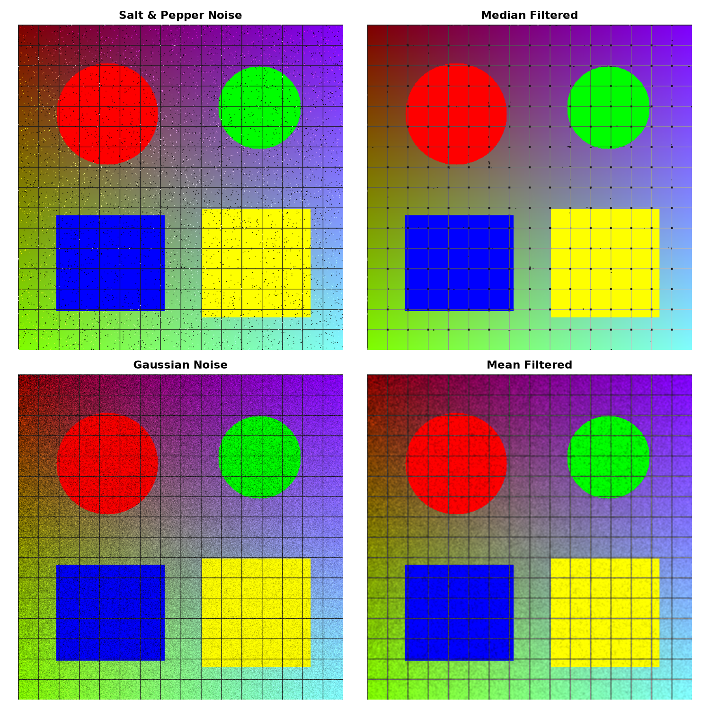

- Salt-and-pepper noise (3%) → **Median filter** removes it, edges stay sharp.
- Gaussian noise (σ = 0.08) → **Mean filter** reduces it, with slight blurring.

## Comparison Summary

| Filter | Domain | Linear? | Effect | Best used for |
|---|---|---|---|---|
| Mean | Spatial | Yes | Blur / smooth | Gaussian noise removal |
| Weighted Average | Spatial | Yes | Mild blur | Noise removal, better detail |
| Gaussian | Spatial | Yes | Smooth blur | Natural smoothing, pre-processing |
| Median | Spatial | No | Removes outliers | Salt-and-pepper noise |
| Laplacian | Spatial | Yes | Sharpens | Edge enhancement |
| Sobel | Spatial | Yes | Edge map | Edge / boundary detection |
| Prewitt | Spatial | Yes | Edge map | Edge / boundary detection |
| High-Boost | Spatial | Yes | Sharpens + retains detail | Detail enhancement |

---

# Part 2 — Image Compression

Both techniques are **lossless** and implemented **from scratch** (no codec
library). The image is taken in grayscale (256×256) as raw bytes, compressed,
then decompressed, and the reconstruction is verified pixel-by-pixel.

## 1. Huffman Coding — `2_Image_Compression/huffman.py`

1. Count the frequency of every pixel value.
2. Build a Huffman tree with a min-heap (repeatedly merge the two least frequent nodes).
3. Read prefix-free codes off the tree — frequent values get short codes, rare values get long codes.
4. Encode the image to a bit-string, pack it into bytes (`.bin` file).
5. Decode by walking the tree bit by bit and rebuild the image.

## 2. Arithmetic Coding — `2_Image_Compression/arithmetic.py`

1. Build a static probability model from the pixel frequencies.
2. Start with interval `[0, 1)` and narrow it for every symbol, in proportion to its probability.
3. The whole image is represented by **one number** inside the final interval —
   implemented as a 32-bit integer coder with E1/E2/E3 renormalisation.
4. Decode by finding which symbol's sub-interval contains the coded value, symbol by symbol.

Unlike Huffman, arithmetic coding is not forced to use a whole number of bits
per symbol, so it can get closer to the entropy limit.

## Results — Original vs Reconstructed

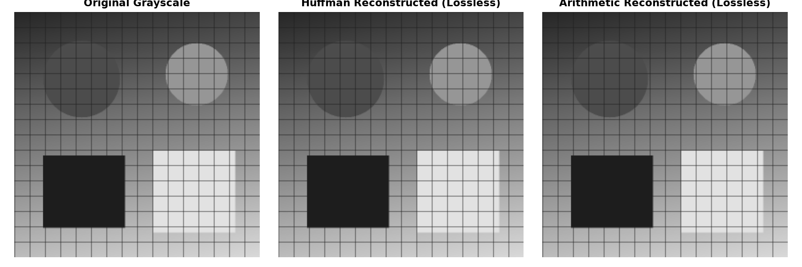

Both reconstructed images are **identical to the original** (lossless — verified
in code with `np.array_equal`, result `lossless: true` for both).

